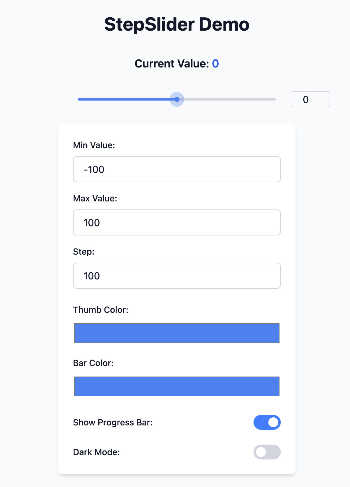

<h1 align="center">🎚️ React Enhanced Slider</h1>

<p align="center">
  <strong>React slider component with step snapping, smooth animations and simple customization</strong>
</p>

<p align="center">
  <a href="https://www.npmjs.com/package/react-enhanced-slider"></a>
  
  <a href="https://react-enhanced-slider.vercel.app"></a>
</p>

<p align="center">
  
</p>

## Features

- Step snapping within a configurable `min` / `max` / `step` range
- Smooth transitions when the value changes (disabled while dragging)
- Mouse and touch dragging
- Built-in number input next to the slider, kept in sync with the thumb
- Custom thumb and bar colors
- TypeScript type definitions included

## Installation

```bash
npm install react-enhanced-slider
```

Requires `react` and `react-dom` 16.8 or later.

## Usage

```tsx
import { useState } from "react";
import { Slider } from "react-enhanced-slider";
import "react-enhanced-slider/dist/index.css";

export default function Example() {
  const [value, setValue] = useState(50);

  return (
    <Slider
      range={{ min: 0, max: 100, step: 5 }}
      defaultValue={50}
      onChange={setValue}
      showBar
      className="w-80"
    />
  );
}
```

The slider keeps its own state: set the starting point with `defaultValue` and read changes through `onChange`.

## Props

| Prop           | Type                                          | Default                           | Description                                      |
| -------------- | --------------------------------------------- | --------------------------------- | ------------------------------------------------ |
| `range`        | `{ min: number; max: number; step: number }`  | `{ min: 0, max: 100, step: 1 }`   | Allowed range and step size                      |
| `defaultValue` | `number`                                      | middle of `range`, snapped to step | Initial value (uncontrolled mode)                |
| `onChange`     | `(value: number) => void`                     | –                                 | Called with the snapped value on change          |
| `showBar`      | `boolean`                                     | `false`                           | Show the filled bar from `min` to the thumb      |
| `thumbColor`   | `string`                                      | `"#3b82f6"`                           | CSS color of the thumb                           |
| `barColor`     | `string`                                      | `"#3b82f6"`                           | CSS color of the filled bar                      |
| `className`    | `string`                                      | –                                 | Extra classes for the outer container            |

## Development

```bash
git clone https://github.com/gxxxr-111/react-enhanced-slider.git
cd react-enhanced-slider
npm install
npm run dev     # Storybook
npm test        # Vitest
npm run build   # Rollup build into dist/
```

## License

MIT
